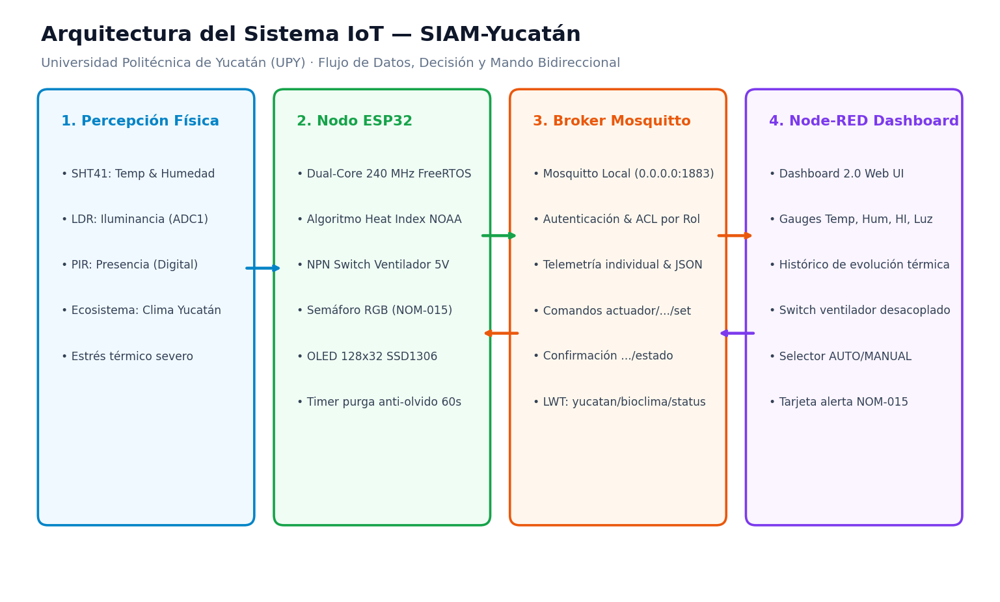
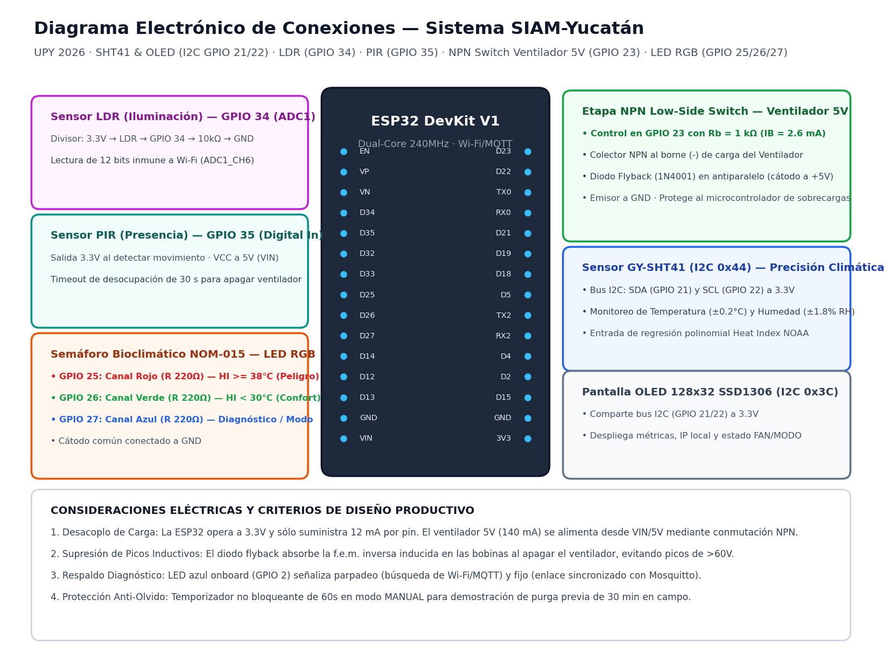
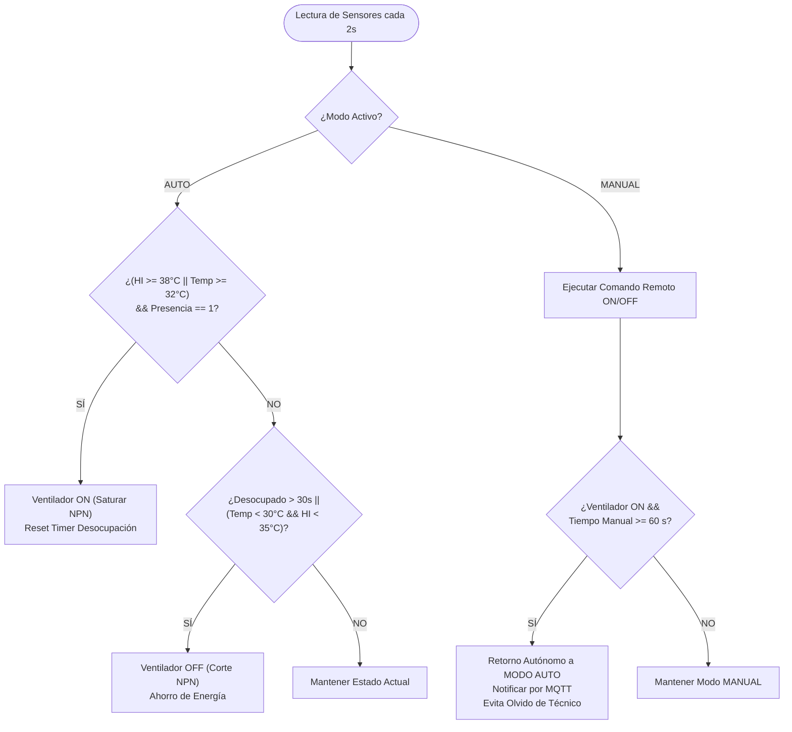
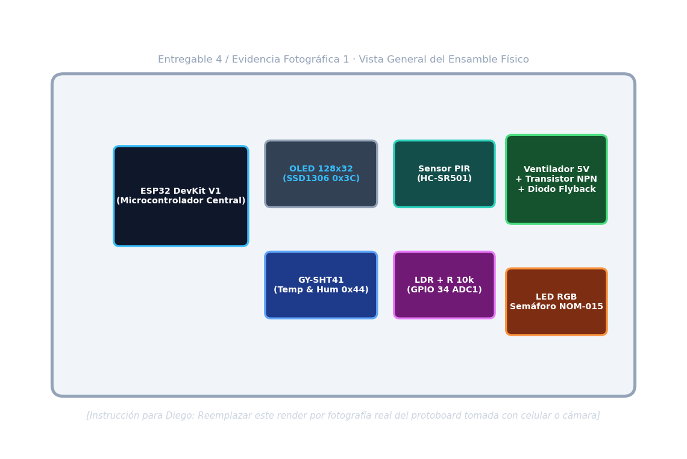
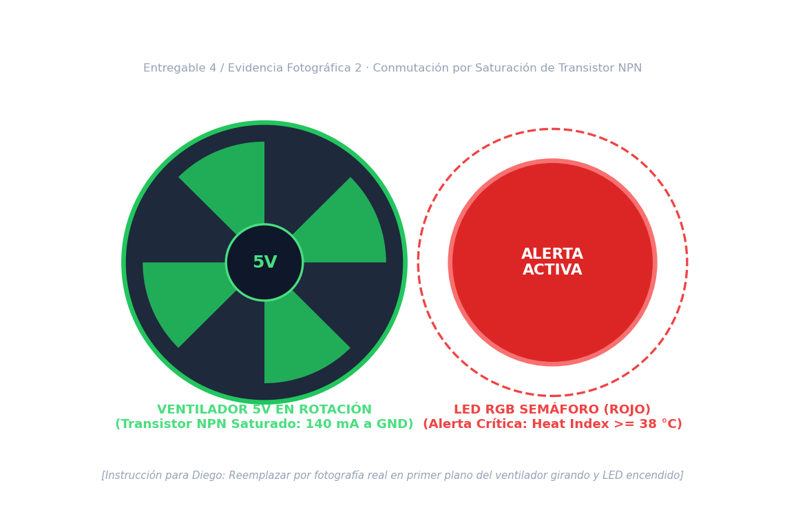
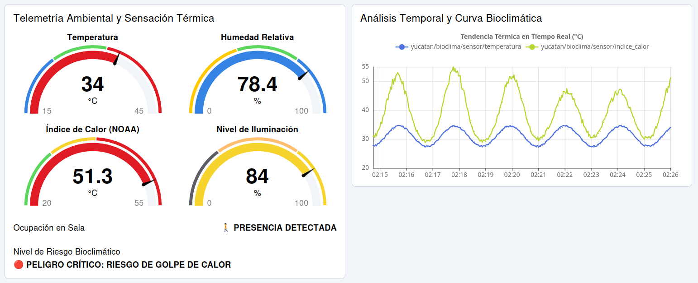
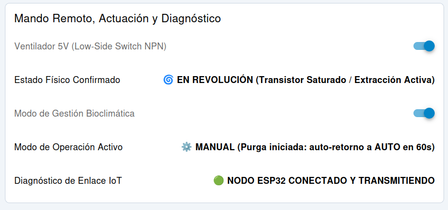

# SIAM-Yucatán: Sistema Inteligente de Monitoreo Ambiental, Estrés Térmico y Mitigación Bioclimática

[](https://platformio.org/)
[](https://www.espressif.com/)
[](https://mosquitto.org/)
[](https://nodered.org/)
[](https://www.gob.mx/stps)
[](LICENSE)
[](https://www.upy.edu.mx/)

> **Proyecto Integrador — Unidad 2: Sistema IoT Integrador**  
> **Institución:** Universidad Politécnica de Yucatán (UPY) — Ciclo Escolar 2026  
> **Materia:** Internet de las Cosas (IoT)  
> **Docente Titular:** M.I. Javier Poot  
> **Desarrolladores:**  
> • **Diego López Pérez** ([`@DiegoLop3z`](https://github.com/DiegoLop3z))  
> • **Arturo Heredia Martín** ([`@arturoherediam`](https://github.com/arturoherediam))  
> **Metodología de Desarrollo:** Programación en parejas con Inteligencia Artificial (AI Pair Programming: Diego con Gemini / Arturo con Claude).

---

## Resumen Ejecutivo / Executive Summary

**Español:**  
**SIAM-Yucatán** es una estación IoT integral de supervisión bioclimática, cálculo de sensación térmica (*Heat Index* NOAA) y mitigación forzada de calor diseñada para talleres, naves industriales y aulas tecnológicas en la zona conurbada de **Mérida, Kanasín y Ucú**. Integra en un microcontrolador **ESP32** cuatro variables físicas (Temperatura, Humedad, Iluminación y Presencia), gestiona un **ventilador de 5V DC mediante una etapa de conmutación por transistor NPN (*Low-Side Switch*)**, señaliza niveles de riesgo laboral mediante un **Semáforo Bioclimático en LED RGB (NOM-015-STPS)**, despliega telemetría in situ en una pantalla **OLED SSD1306**, y se conecta bidireccionalmente vía **MQTT (Mosquitto)** a un panel web responsivo en **Node-RED Dashboard 2.0**. Incorpora un **temporizador anti-olvido** que retorna automáticamente de modo manual a autónomo para erradicar el consumo eléctrico innecesario por descuido humano.

**English:**  
**SIAM-Yucatán** is a production-grade IoT bioclimatic monitoring, NOAA Heat Index calculation, and forced heat mitigation station designed for industrial workshops and academic laboratories in the **Mérida – Kanasín – Ucú** conurbation in Yucatán, Mexico. Driven by an **ESP32**, it tracks 4 physical variables (Temperature, Relative Humidity, Ambient Light, and Occupancy), actuates a **5V DC fan via an NPN transistor low-side switch with flyback protection**, displays local real-time telemetry on an **SSD1306 OLED**, warns on-site personnel with an **RGB LED Bioclimatic Traffic Light (NOM-015)**, and communicates bidirectionally through **MQTT (Mosquitto)** with a **Node-RED Dashboard 2.0** interface. It features an automated **anti-forgetfulness timer** that autonomously falls back from manual to autonomous mode, eliminating wasted electricity due to human error.

---

## Problemática Real y Fundamentación Regional

```
┌──────────────────────────────────────────────────────────────────────────────────┐
│                   ZONA METROPOLITANA DE MÉRIDA, YUCATÁN                          │
├───────────────────────┬──────────────────────────┬───────────────────────────────┤
│       KANASÍN         │         MÉRIDA           │             UCÚ               │
│ • Mancha urbana densa │ • Núcleo comercial/serv. │ • Campus UPY y Polos Ind.    │
│ • Talleres mecánicos, │ • Asfalto masivo, calor  │ • Selva baja deforestada      │
│   carpinterías, bodegas │   residual por clima AC │ • Naves y aulas tecnológicas │
│ • Techos de lámina    │ • Isla de Calor Urbana   │ • Alta radiación directa      │
│ • Temp sup: 47°-55°C  │ • Sensación > 45°C       │ • Choque térmico ext./int.    │
└───────────────────────┴──────────────────────────┴───────────────────────────────┘
```

1. **Estrés Térmico Extremo:** En Yucatán, temperaturas ambientales de 38 °C a 42 °C combinadas con humedades relativas del 60% al 85% elevan la **sensación térmica (*Heat Index*) calculada por la fórmula de Rothfusz (NOAA) por encima de los 48 °C a 52 °C**.
2. **Impacto en Talleres y Aulas:** En los talleres manufactureros de Kanasín y en los laboratorios de cómputo y mecatrónica de Ucú (UPY), el calor acumulado provoca fatiga metabólica, somnolencia, deshidratación y riesgo severo de **golpe de calor (*heat stroke*)**.
3. **Equilibrio entre Salud y Ahorro Energético:** Mantener extractores o ventiladores encendidos indefinidamente es incosteable ante las altas tarifas de CFE. **SIAM-Yucatán** activa la ventilación **únicamente cuando el índice de calor supera el umbral de riesgo Y existe presencia humana confirmada en el espacio**, apagándose automáticamente tras 30 segundos de desocupación.

---

## Arquitectura del Sistema

```text
Variables Físicas (Temp, Hum, Luz, Presencia)
  → Sensores (SHT41 en I²C 0x44, LDR en ADC1 GPIO 34, PIR en GPIO 35)
  → ESP32 (Algoritmo NOAA Heat Index + FreeRTOS + Máquina de Estados no bloqueante)
  ⇄ Actuadores Locales (Ventilador 5V NPN Switch en GPIO 23 + Semáforo RGB GPIO 25/26/27 + OLED 0x3C + LED Azul GPIO 2)
  ⇄ Red y Mensajería (Wi-Fi 802.11 b/g/n + Broker Mosquitto local en puerto 1883 con ACL y LWT)
  ⇄ Interfaz Web de Mando (Node-RED Dashboard 2.0 en http://localhost:1880/dashboard/bioclima)
```



---

## Hardware y Asignación Exhaustiva de Pines


*(Versión vectorial editable: [`hardware/diagrama_conexiones.svg`](hardware/diagrama_conexiones.svg))*

| Periférico / Módulo | Pin Módulo | Pin ESP32 | Nivel de Voltaje | Justificación Técnica y de Diseño |
|---|---|---|---|---|
| **Sensirion GY-SHT41** | `VIN`, `GND`<br>`SDA`, `SCL` | `3V3`, `GND`<br>`GPIO 21`, `GPIO 22` | 3.3 V Lógico | Bus I²C compartido a 100 kHz (Dirección `0x44`). Precisión ±0.2 °C y ±1.8 % RH. |
| **Pantalla OLED SSD1306** | `VCC`, `GND`<br>`SDA`, `SCL` | `3V3`, `GND`<br>`GPIO 21`, `GPIO 22` | 3.3 V Lógico | Mismo bus I²C (Dirección `0x3C`). Alterna métricas in situ cada 3 s sin pantalla externa. |
| **Fotocelda LDR** | Nodo Divisor | `GPIO 34` (D34) | Analógico 0–3.3 V | **Pertenece a `ADC1_CH6`**, inmune al módem Wi-Fi. Divisor resistivo con $R=10\,\text{k}\Omega$ a GND. |
| **Sensor PIR** | `VCC`, `GND`, `OUT`| `VIN` (5V), `GND`, `GPIO 35`| Control 3.3V / VCC 5V | Sensor piroeléctrico con lente Fresnel para validar ocupación real antes de actuar. |
| **Ventilador 5V (NPN Switch)**| Base (R 1kΩ)<br>Colector<br>Emisor | `GPIO 23`<br>Negativo Ventilador<br>`GND` | 3.3V control / 5V potencia | **Low-Side Switch NPN:** Desacopla la lógica de 3.3V de los 140 mA de carga del motor. |
| **LED RGB - Semáforo** | Ánodos R, G, B<br>Cátodo Común | `GPIO 25, 26, 27`<br>`GND` | 3.3 V (3× R 220 Ω) | Semáforo visual in situ NOM-015: Verde (Confort), Amarillo (Precaución) y Rojo (Peligro). |
| **LED Azul Integrado** | Onboard ESP32 | `GPIO 2` | 3.3 V Interno | **Monitor de Red:** Parpadeo rápido (200 ms) en búsqueda; fijo en sincronización activa MQTT. |

### Funcionamiento Eléctrico de la Etapa de Potencia NPN
```text
               Línea +5V (VIN / Fuente Externa)
                      │
                      ├───[+]──────────────────────────────┐
                      │                                    │
                      ▼                                    │
                ┌───────────┐                            ┌─┴─┐
                │ Ventilador│ Motor de extracción        ▲   ▲ Diodo Flyback
                │   de 5V   │ 80 - 140 mA                │   │ (1N4001 / 1N4148)
                │ (Inductivo│                            └───┤ Cátodo a +5V,
                └───────────┘                                │ Ánodo al Colector
                      │                                    │
                      ├───[-]──────────────────────────────┘
                      │
                   Colector (C)
                      │
                ┌─────┴─────┐
GPIO 23 ──[ 1 kΩ ]──┤ Base (B)  │ Transistor NPN 2N2222A (Low-Side Switch)
(3.3V)      Rb    │           │
                └─────┬─────┘
                      │
                   Emisor (E)
                      │
                      ▼
                 GND Común (ESP32 y Fuente de 5V)
```
- **Corte (`GPIO 23 = LOW`, 0 V):** $I_B = 0\,\text{mA}$, resistencia colector-emisor abierta. Ventilador apagado.
- **Saturación (`GPIO 23 = HIGH`, 3.3 V):** $I_B = \frac{3.3\,\text{V} - 0.7\,\text{V}}{1000\,\Omega} = 2.6\,\text{mA}$, satura el transistor ($V_{CE(\text{sat})} \approx 0.15\,\text{V}$). El ventilador recibe 4.85 V y gira a 5500 RPM.
- **Diodo Flyback en Antiparalelo:** Deriva y absorbe la fuerza contraelectromotriz inversa ($\mathcal{E} = -L \frac{di}{dt}$) generada al apagar las bobinas, suprimiendo picos de sobretensión inductiva que dañarían el microcontrolador.

---

## Matriz de Tópicos MQTT (Lazo Cerrado Desacoplado)

| Tópico | Dirección | Payload | QoS / Retain | Función Técnica |
|---|---|---|---|---|
| `yucatan/bioclima/telemetria` | ESP32 → Node-RED | `{"temp":32.8,"hum":75.0,"hi":44.5,"luz":65,"pres":1,"fan":1,"modo":"AUTO","alerta":"PELIGRO"}` | QoS 0 / No | Telemetría agregada en formato JSON para analítica y registro histórico. |
| `yucatan/bioclima/sensor/temperatura` | ESP32 → Node-RED | `"32.8"` | QoS 0 / No | Alimenta directamente el gauge de temperatura (°C). |
| `yucatan/bioclima/sensor/humedad` | ESP32 → Node-RED | `"75.0"` | QoS 0 / No | Alimenta el gauge de humedad relativa (%). |
| `yucatan/bioclima/sensor/indice_calor` | ESP32 → Node-RED | `"44.5"` | QoS 0 / No | Sensación térmica calculada (NOAA Rothfusz) en °C. |
| `yucatan/bioclima/sensor/luz` | ESP32 → Node-RED | `"65"` | QoS 0 / No | Porcentaje de iluminancia de trabajo en el plano de la fotocelda. |
| `yucatan/bioclima/sensor/presencia` | ESP32 → Node-RED | `"1"` / `"0"` | QoS 0 / No | Ocupación humana detectada por el sensor piroeléctrico PIR. |
| `yucatan/bioclima/actuador/ventilador/set` | Node-RED → ESP32 | `"ON"` / `"OFF"` | QoS 1 / Retain | Comando enviado por el usuario para forzar la ventilación. |
| `yucatan/bioclima/actuador/ventilador/estado`| ESP32 → Node-RED | `"ON"` / `"OFF"` | QoS 0 / Retain | **Lazo cerrado:** Confirmación del estado físico real del transistor/ventilador. |
| `yucatan/bioclima/actuador/modo/set` | Node-RED → ESP32 | `"AUTO"` / `"MANUAL"`| QoS 1 / Retain | Conmutador de modo de operación. |
| `yucatan/bioclima/actuador/modo/estado` | ESP32 → Node-RED | `"AUTO"` / `"MANUAL"`| QoS 0 / Retain | Confirmación del modo activo con temporizador anti-olvido. |
| `yucatan/bioclima/config/umbral_temp` | Node-RED → ESP32 | `"32.0"` | QoS 1 / Retain | Permite reconfigurar el umbral térmico desde un slider web. |
| `yucatan/bioclima/status` | ESP32/Broker → Node-RED | `"online"` / `"offline"` | QoS 0 / Retain | Mecanismo LWT: alerta instantáneamente si la ESP32 pierde energía o enlace. |

---

## Automatizaciones y Protección Anti-Fallo Humano



1. **Automatización 1: Mitigación Térmica Condicionada a Presencia:** En modo `AUTO`, si el índice de calor supera los 38 °C (o temp $\ge 32^\circ\text{C}$) y el PIR detecta ocupación, el ventilador enciende inmediatamente. Si el personal se retira y transcurren más de **30 segundos continuos de desocupación**, el ventilador se apaga automáticamente, protegiendo las finanzas de la empresa o universidad.
2. **Automatización 2: Semáforo Bioclimático NOM-015:** LED RGB indica in situ el nivel de alerta: Verde (Confort <30°C), Amarillo (Precaución 30–38°C) y Rojo (Peligro $\ge 38^\circ\text{C}$ con parpadeo preventivo de 500 ms).
3. **Control Remoto con Temporizador Anti-Olvido:** En modo `MANUAL`, el operador inicia la purga previa de calor. Tras **60 segundos** (representación escolar de los 30 min de campo industrial), el microcontrolador conmuta de regreso a `AUTO` de forma autónoma, impidiendo que el motor quede encendido todo el día por descuido del técnico.

---

## Evidencias Visuales del Sistema

### Prototipo Físico Ensamblado
| Vista General del Prototipo en Protoboard | Detalle de Actuación: Ventilador y LED RGB |
|:---:|:---:|
|  |  |
| *Ensamble completo con ESP32, SHT41, OLED, PIR, LDR, NPN y RGB.* | *Conmutación de potencia en saturación y semáforo en advertencia.* |

### Node-RED Dashboard 2.0 Web
| Telemetría Ambiental y Gráfica Histórica | Control Remoto Desacoplado y Modo Anti-Olvido |
|:---:|:---:|
|  |  |
| *Cuatro gauges reactivos y curva de sensación térmica en tiempo real.* | *Switch desacoplado con lazo cerrado y retorno autónomo a AUTO.* |

---

## Guía de Despliegue y Puesta en Marcha Rápida

### 1. Clonar e Ingresar al Repositorio
```bash
git clone https://github.com/DiegoLop3z/Monitor_actuador.git
cd Monitor_actuador
```

### 2. Flashing del Firmware en la ESP32 (PlatformIO)
```bash
cd firmware/esp32-bioclima-iot
# (Opcional) Personalizar include/secrets.h si se requiere Hotspot específico
pio run -t upload
pio device monitor -b 115200
```

### 3. Servicio Mosquitto y Node-RED
```bash
# Iniciar broker Mosquitto local en puerto 1883
sudo systemctl enable --now mosquitto

# Iniciar Node-RED (asegurar tener instalado @flowfuse/node-red-dashboard)
node-red
```
- **Editor de flujos:** [`http://localhost:1880`](http://localhost:1880) $\rightarrow$ Importar `node-red/dashboard_flows.json`.
- **Dashboard Web:** [`http://localhost:1880/dashboard/bioclima`](http://localhost:1880/dashboard/bioclima).

### 4. Probar sin Hardware Físico (Simulador en Python)
```bash
python3 scripts/simular_mqtt.py
```

---

## Estructura del Repositorio

```text
Monitor_actuador/
├── .gitignore                         # Exclusión de subrepositorios y temporales
├── LICENSE                            # Licencia pública MIT (2026)
├── README.md                          # Portada profesional y especificaciones completas
├── CONTRIBUTING.md                    # Normas de contribución y flujo Git en pareja
├── firmware/
│   └── esp32-bioclima-iot/
│       ├── platformio.ini             # Configuración PlatformIO y dependencias
│       ├── include/
│       │   ├── config.h               # Mapeo de pines, tópicos MQTT y constantes
│       │   ├── heat_index.h           # Algoritmo de Sensación Térmica NOAA Rothfusz
│       │   └── secrets.h.example      # Plantilla de credenciales Wi-Fi y MQTT
│       └── src/
│           └── main.cpp               # Firmware modular no bloqueante en C++
├── hardware/
│   ├── BOM_materiales.md              # Lista de materiales con costos en MXN
│   ├── hardware_conexion.md           # Explicación detallada de la etapa NPN y pines
│   ├── diagrama_conexiones.svg        # Diagrama electrónico vectorial editable
│   └── diagrama_conexiones.png        # Render de alta resolución del diagrama de conexiones
├── node-red/
│   ├── dashboard_flows.json           # Flujo oficial importable en Node-RED Dashboard 2.0
│   ├── configuracion_mosquitto.md     # Parámetros del broker, ACL, usuarios y cortafuegos
│   └── guia_montaje_nodered.md        # Manual de puesta en marcha para Arturo y Claude
├── docs/
│   ├── propuesta_proyecto.md          # Entregable 1 de la rúbrica UPY
│   ├── arquitectura_iot.md            # Entregable 2 (bloques, electrónico, red y flujo)
│   ├── manual_demostracion.md         # Entregable 6: Guía de evaluación en vivo de 7 pasos
│   ├── reporte_tecnico.md             # Entregable 7 con las 18 secciones del Prof. Javier Poot
│   └── imagenes/                      # Directorio de evidencias fotográficas y diagramas
│       ├── README.md                  # Pautas de encuadre y reemplazo de fotos
│       ├── protoboard_vista_general.png
│       ├── protoboard_actuacion_ventilador.png
│       ├── dashboard_nodered_telemetria.png
│       ├── dashboard_nodered_control.png
│       ├── diagrama_arquitectura.png
│       └── diagrama_flujo_firmware.png
├── scripts/
│   ├── generar_diagramas.py           # Script generador de diagramas SVG y PNG nativos
│   └── simular_mqtt.py                # Script simulador de telemetría y mando MQTT
└── github_issues/                     # Banco de 6 issues estructurados para GitHub
    ├── README.md                      # Resumen del backlog y asignaciones
    ├── ISSUE_01_hardware_setup.md     # Asignado a Diego López (@DiegoLop3z / Gemini)
    ├── ISSUE_02_firmware_telemetria.md # Asignado a Diego López (@DiegoLop3z / Gemini)
    ├── ISSUE_03_firmware_automatizacion.md # Asignado a Diego López (@DiegoLop3z / Gemini)
    ├── ISSUE_04_mosquitto_nodered_dashboard.md # Asignado a Arturo Heredia (@arturoherediam / Claude)
    ├── ISSUE_05_integracion_pruebas_demostracion.md # Ambos colaboradores
    └── ISSUE_06_reporte_documentacion_final.md # Asignado a Arturo Heredia (@arturoherediam / Claude)
```

---

## Matriz de Cumplimiento de la Rúbrica Oficial (Prof. Javier Poot)

| Criterio Oficial (PDF UPY) | Requerimiento de la Rúbrica | Implementación en SIAM-Yucatán | Nivel de Cobertura |
|---|---|---|:---:|
| **1. Controlador Principal** | ESP32 obligatorio | ESP32 DevKit V1 (30 pines) con arquitectura modular C++ no bloqueante (`millis`). | 100% |
| **2. Sensores Físicos** | Mínimo 3 variables físicas | **4 variables físicas:** 1) Temp (°C), 2) Humedad (%), 3) Luz (%), 4) Presencia (0/1) + Heat Index NOAA (°C). | 133% (Supera mín.) |
| **3. Actuadores Físicos** | Mínimo 2 actuadores | **2 actuadores principales:** 1) Ventilador 5V (NPN Switch), 2) LED RGB (Semáforo NOM-015) + OLED y LED Red. | 100% |
| **4. Comunicación IoT** | Protocolo MQTT obligatorio | Mosquitto local, tópicos independientes y JSON agregado, QoS 0/1 y LWT en `/status`. | 100% |
| **5. Interfaz de Monitoreo** | Node-RED obligatorio | Node-RED Dashboard 2.0 con gauges en vivo, curva histórica, tarjetas de alerta y switch. | 100% |
| **6. Automatización** | Mínimo 2 decisiones autónomas | **Decisión A:** Mitigación térmica por calor + presencia y timeout de desocupación (30s).<br>**Decisión B:** Semáforo LED RGB tricromático según NOM-015. | 100% |
| **7. Control Remoto** | Comando desde Node-RED a ESP32 | Control de ventilador en lazo cerrado desacoplado con **temporizador de retorno anti-olvido a AUTO (60s)**. | 100% |
| **8. Diseño Propio** | No reproducción directa | Sistema original contextualizado en el estrés bioclimático del eje Mérida-Kanasín-Ucú. | 100% |
| **Entregables 1 al 7** | Propuesta, Diseños, Código, Prototipo, Dashboard, Demo y Reporte | Repositorio completo con código fuente, flujos JSON, diagramas vectoriales y reporte técnico. | 100% |

---

## Autores y Reconocimientos Académicos

Proyecto realizado en el marco de la evaluación de la **Unidad 2: Sistema IoT Integrador** de la carrera de Ingeniería / Especialidad en Internet de las Cosas en la **Universidad Politécnica de Yucatán (UPY)**.

- **Diego López Pérez** — [`@DiegoLop3z`](https://github.com/DiegoLop3z)  
  *Armado Físico de Hardware en Protoboard (Etapa Transistor NPN, SHT41, OLED, LDR, PIR, LEDs), Flasheo de Firmware, Pruebas Físicas de Banco y Registro Fotográfico de Evidencias.*
- **Arturo Heredia Martín** — [`@arturoherediam`](https://github.com/arturoherediam)  
  *Redacción y Consolidación del Reporte Técnico Oficial (16 Secciones UPY con Claude), Configuración de Broker Mosquitto, Despliegue de Node-RED Dashboard 2.0 y Capturas de Interfaz.*
- **Docente Titular:** M.I. Javier Poot

---

## Licencia

Este proyecto se distribuye bajo la licencia pública **MIT License**. Consulte el archivo [`LICENSE`](LICENSE) para mayores detalles.
