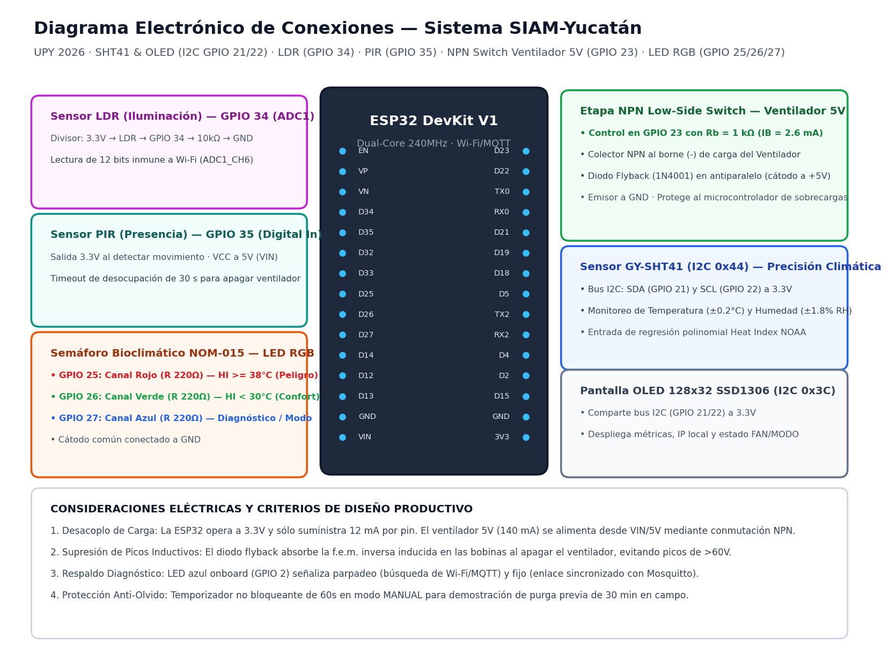
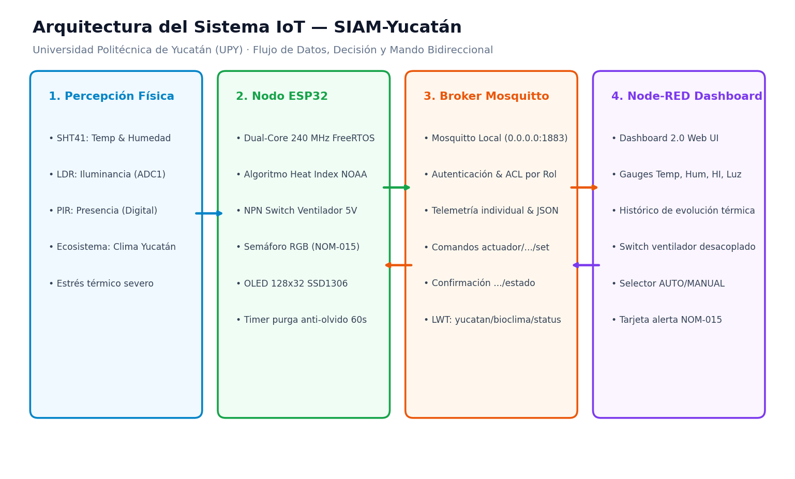
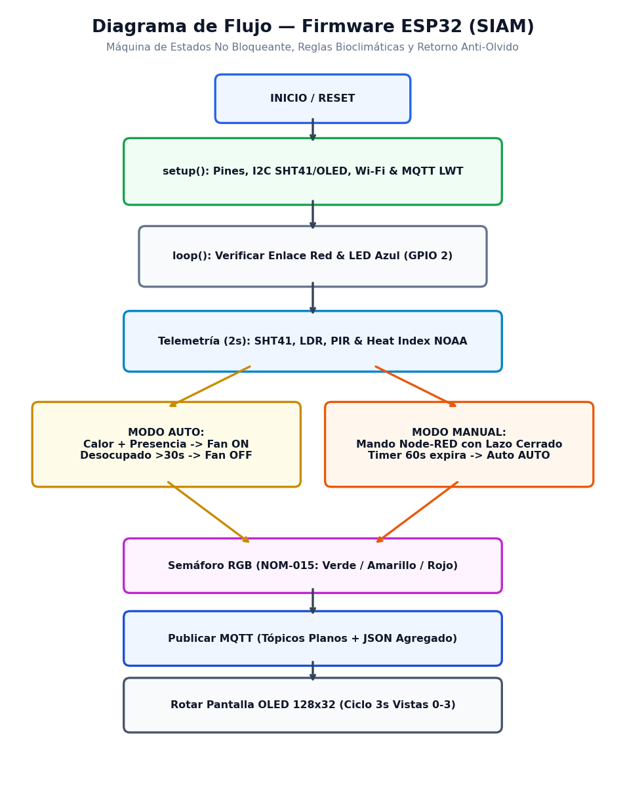

# Arquitectura del Sistema IoT: SIAM-Yucatán
## Entregable 2 — Diseños Estructurales, Electrónicos, Red y Flujo

> **Evaluación Unidad 2: Sistema IoT Integrador — Entregable 2**  
> **Universidad Politécnica de Yucatán (UPY) — Ciclo Escolar 2026**  
> **Docente:** M.I. Javier Poot  
> **Autores:** Diego López Pérez ([`@DiegoLop3z`](https://github.com/DiegoLop3z)) & Arturo Heredia Martín ([`@arturoherediam`](https://github.com/arturoherediam))

---

## 1. Diagrama de Bloques General del Sistema

El sistema **SIAM-Yucatán** integra la captura sensorial, procesamiento embebido, conmutación de actuadores de potencia y señalización visual, vinculados mediante una red inalámbrica Wi-Fi local hacia un broker MQTT y una plataforma de visualización web:

```text
┌────────────────────────────────────────────────────────────────────────────────────────┐
│                               CAPA 1: SENSORES FÍSICOS                                 │
├──────────────────────────┬─────────────────────────────┬───────────────────────────────┤
│    Sensirion GY-SHT41    │        Fotocelda LDR        │      Sensor PIR HC-SR501      │
│   Temperatura y Humedad  │     Iluminación Laboral     │       Presencia Humana        │
│   (Bus I²C 0x44 · 3.3V)  │    (Divisor ADC1_CH6 D34)   │     (Entrada Digital D35)     │
└────────────┬─────────────┴──────────────┬──────────────┴───────────────┬───────────────┘
             │                            │                              │
             ▼                            ▼                              ▼
┌────────────────────────────────────────────────────────────────────────────────────────┐
│                        CAPA 2: MICROCONTROLADOR CENTRAL (ESP32)                        │
├────────────────────────────────────────────────────────────────────────────────────────┤
│ • Muestreo no bloqueante con millis() (Ciclo de telemetría cada 2000 ms)               │
│ • Algoritmo de Regresión Polinomial de Rothfusz (Índice de Calor / Heat Index NOAA)    │
│ • Máquina de Estados: Modo AUTO vs Modo MANUAL con temporizador de purga anti-olvido   │
│ • Control de Señalización: Semáforo NOM-015 y Diagnóstico de Red (LED Azul GPIO 2)     │
│ • Cliente MQTT PubSubClient con reconexión automática y mensaje LWT ('offline')        │
└────────────┬────────────────────────────┬──────────────────────────────┬───────────────┘
             │                            │                              │
             ▼                            ▼                              ▼
┌──────────────────────────┬─────────────────────────────┬───────────────────────────────┐
│       ACTUADOR 1         │         ACTUADOR 2          │          MONITORES            │
│ Ventilador de 5V DC      │ LED RGB Semáforo NOM-015    │ • Pantalla OLED 128x32 (0x3C) │
│ Etapa NPN Low-Side (D23) │ Canales R, G, B (D25,26,27) │ • LED Azul Red Onboard (D2)   │
└──────────────────────────┴─────────────────────────────┴───────────────────────────────┘
             ▲                                                           │
             │ Confirmación / Comandos MQTT                              │ Publicaciones
             ▼                                                           ▼
┌────────────────────────────────────────────────────────────────────────────────────────┐
│                        CAPA 3: SERVICIO IOT (BROKER MOSQUITTO)                         │
├────────────────────────────────────────────────────────────────────────────────────────┤
│ • Protocolo MQTT v3.1.1 en puerto 0.0.0.0:1883 · Control de Acceso por Roles (ACL)     │
│ • Tópicos jerárquicos: yucatan/bioclima/telemetria, sensor/+, actuador/+/set y estado  │
│ • Gestión de Last Will and Testament en yucatan/bioclima/status                        │
└──────────────────────────────────────────┬─────────────────────────────────────────────┘
                                           ▲
                                           │ WebSockets / MQTT Local
                                           ▼
┌────────────────────────────────────────────────────────────────────────────────────────┐
│                   CAPA 4: SUPERVISIÓN Y CONTROL (NODE-RED DASHBOARD 2.0)               │
├────────────────────────────────────────────────────────────────────────────────────────┤
│ • Gauges analógicos: Temperatura (°C), Humedad (%), Heat Index (°C) y Luz (%)          │
│ • Gráfico dinámico de tendencia temporal de evolución térmica                          │
│ • Switch desacoplado del ventilador con confirmación en lazo cerrado                   │
│ • Selector de modo AUTO / MANUAL con alerta del temporizador anti-olvido (60 s)        │
│ • Monitor de estado de conectividad en vivo del nodo ESP32                            │
└────────────────────────────────────────────────────────────────────────────────────────┘
```

---

## 2. Diagrama Electrónico de Conexiones


*(Versión vectorial editable disponible en: [`hardware/diagrama_conexiones.svg`](../hardware/diagrama_conexiones.svg))*

### 2.1 Explicación de la Etapa de Potencia del Ventilador (Transistor NPN)
Para disipar calor de forma activa, se requiere un flujo de aire forzado generado por un ventilador de 5V DC. Dado que el pin del microcontrolador sólo opera a 3.3V y soporta un máximo seguro de 12 mA, se implementa una configuración de **conmutador por lado bajo (*Low-Side Switch*) con transistor NPN (2N2222A)** en `GPIO 23`:
1. **Lazo de Control:** El pin `GPIO 23` alimenta la base del transistor a través de un resistor $R_b = 1\,\text{k}\Omega$. Al emitir nivel `HIGH` (3.3V), circula una corriente de base $I_B = \frac{3.3\,\text{V} - 0.7\,\text{V}}{1000\,\Omega} = 2.6\,\text{mA}$, suficiente para saturar el transistor.
2. **Lazo de Potencia:** En saturación, la tensión colector-emisor cae a $V_{CE(\text{sat})} \approx 0.15\,\text{V}$, cerrando el retorno a tierra para el motor del ventilador, permitiendo un flujo de corriente de 140 mA desde la línea de +5V (VIN).
3. **Diodo Flyback en Antiparalelo (1N4001):** Colocado en paralelo inverso con la carga inductiva del ventilador (cátodo a +5V, ánodo al colector), absorbe los picos de fuerza contraelectromotriz ($\mathcal{E} = -L \frac{di}{dt}$) generados durante la conmutación a corte, blindando al ESP32 contra transitorios de sobretensión.

---

## 3. Arquitectura IoT y Flujo de Comunicación MQTT


*(Versión vectorial SVG disponible en: [`docs/diagrama_arquitectura.svg`](diagrama_arquitectura.svg))*

### Matriz Estricta de Tópicos MQTT
| Tópico | Dirección | Tipo Payload | QoS / Retain | Función Técnica |
|---|---|---|---|---|
| `yucatan/bioclima/telemetria` | ESP32 → Node-RED | JSON estructurado | QoS 0 / No | Objeto con métricas (`temp`, `hum`, `hi`, `luz`, `pres`, `fan`, `modo`, `alerta`). |
| `yucatan/bioclima/sensor/temperatura` | ESP32 → Node-RED | Float plano (`"33.2"`) | QoS 0 / No | Alimenta directamente el gauge de temperatura en Node-RED. |
| `yucatan/bioclima/sensor/humedad` | ESP32 → Node-RED | Float plano (`"78.0"`) | QoS 0 / No | Alimenta el gauge de humedad relativa. |
| `yucatan/bioclima/sensor/indice_calor` | ESP32 → Node-RED | Float plano (`"44.5"`) | QoS 0 / No | Sensación térmica calculada (NOAA) para análisis de estrés bioclimático. |
| `yucatan/bioclima/sensor/luz` | ESP32 → Node-RED | Entero (`"68"`) | QoS 0 / No | Porcentaje de iluminancia de trabajo (LDR en ADC1). |
| `yucatan/bioclima/sensor/presencia` | ESP32 → Node-RED | Binario (`"1"` / `"0"`) | QoS 0 / No | Estado de ocupación humana en sala (PIR en GPIO 35). |
| `yucatan/bioclima/actuador/ventilador/set` | Node-RED → ESP32 | `"ON"` / `"OFF"` | QoS 1 / Retain | Comando de control manual enviado por el operador. |
| `yucatan/bioclima/actuador/ventilador/estado`| ESP32 → Node-RED | `"ON"` / `"OFF"` | QoS 0 / Retain | **Lazo cerrado:** Confirmación del estado físico real del transistor/ventilador. |
| `yucatan/bioclima/actuador/modo/set` | Node-RED → ESP32 | `"AUTO"` / `"MANUAL"`| QoS 1 / Retain | Conmutador de modo de operación. |
| `yucatan/bioclima/actuador/modo/estado` | ESP32 → Node-RED | `"AUTO"` / `"MANUAL"`| QoS 0 / Retain | Confirmación del modo activo con temporizador anti-olvido. |
| `yucatan/bioclima/config/umbral_temp` | Node-RED → ESP32 | Float (`"32.0"`) | QoS 1 / Retain | Ajuste dinámico del umbral térmico desde la interfaz web. |
| `yucatan/bioclima/status` | ESP32/Broker → Node-RED | `"online"` / `"offline"` | QoS 0 / Retain | Mensaje de presencia y mecanismo LWT del dispositivo. |

---

## 4. Diagrama de Flujo Lógico del Firmware


*(Versión vectorial SVG disponible en: [`docs/diagrama_flujo_firmware.svg`](diagrama_flujo_firmware.svg))*

### Principio de Operación No Bloqueante:
1. **Inicialización (`setup`):** Se configuran pines, bus I²C a 100 kHz, detección de SHT41 y OLED SSD1306, conexión Wi-Fi en modo estación y configuración del cliente MQTT con buffer de 512 bytes y mensaje LWT en `yucatan/bioclima/status`.
2. **Bucle de Mantenimiento (`loop`):**
   - **Diagnóstico de Red:** Si falta Wi-Fi o MQTT, el LED azul integrado (`GPIO 2`) parpadea cada 200 ms. Cuando la conexión y suscripción están activas, permanece encendido fijo.
   - **Cadencia de Adquisición (2000 ms):** Lectura del SHT41, cálculo polinomial de la sensación térmica de Rothfusz, lectura analógica en ADC1 del LDR y lectura digital del PIR.
   - **Evaluación de Automatizaciones:**
     - Si está en `AUTO`: si el índice de calor supera el umbral Y hay presencia humana, satura el transistor NPN (`GPIO 23 = HIGH`) activando el ventilador. Si el espacio permanece desocupado por más de 30 segundos, o la temperatura desciende bajo el rango de histéresis, corta el transistor (`GPIO 23 = LOW`).
     - Si está en `MANUAL`: atiende comandos directos y ejecuta el temporizador anti-olvido: tras 60 segundos de purga, conmuta autónomamente de vuelta a `AUTO`.
   - **Semáforo Visual NOM-015:** Asigna los colores Verde, Amarillo o Rojo parpadeante al LED RGB según el estrés térmico.
   - **Publicación MQTT:** Emite tópicos individuales y el payload JSON agregado.
   - **Rotación OLED (3000 ms):** Alterna pantallas de telemetría, NOM-015, sensores analógicos y diagnóstico de red sin bloquear la ejecución.
