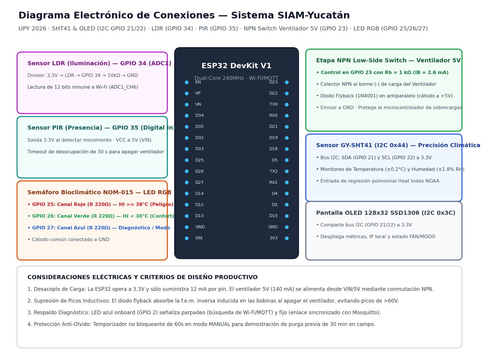
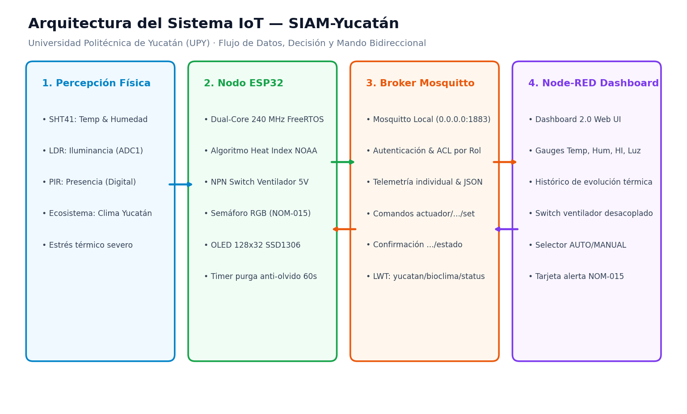
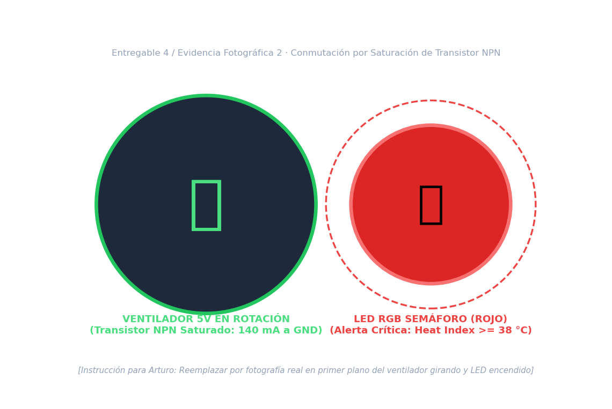
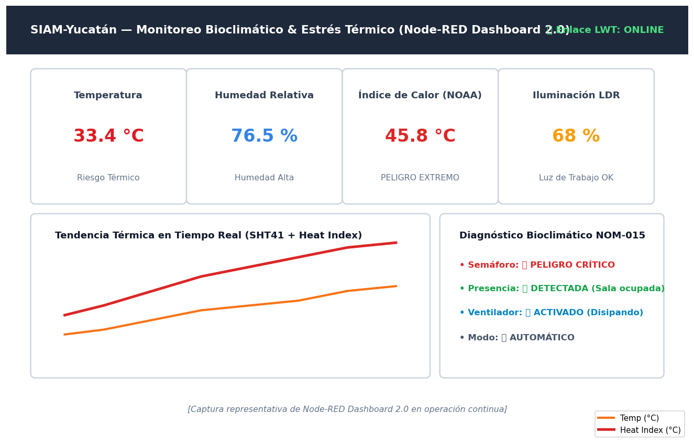

# Reporte Técnico Oficial: SIAM-Yucatán
## Sistema Inteligente de Monitoreo Ambiental, Estrés Térmico y Mitigación Bioclimática

> **Evaluación Unidad 2: Sistema IoT Integrador — Entregable 7**  
> **Institución:** Universidad Politécnica de Yucatán (UPY) — Ciclo Escolar 2026  
> **Materia:** Internet de las Cosas (IoT)  
> **Docente Titular:** M.I. Javier Poot  
> **Integrantes del Equipo (Estudiantes):**  
> • **Diego López Pérez** (GitHub: [`@DiegoLop3z`](https://github.com/DiegoLop3z))  
> • **Arturo Heredia Martín** (GitHub: [`@arturoherediam`](https://github.com/arturoherediam))  
> **Metodología de Trabajo:** Programación en parejas con Inteligencia Artificial (AI Pair Programming: Gemini & Claude)

---

## 1. Portada

```text
========================================================================================
                       UNIVERSIDAD POLITÉCNICA DE YUCATÁN (UPY)
                                SUBDIRECCIÓN ACADÉMICA
                             INGENIERÍA Y ESPECIALIDAD IOT
                                 CICLO ESCOLAR 2026

                                   REPORTE TÉCNICO
                            PROYECTO INTEGRADOR UNIDAD 2:
    "SISTEMA INTELIGENTE DE MONITOREO AMBIENTAL, ESTRÉS TÉRMICO Y MITIGACIÓN BIOCLIMÁTICA"
                                    (SIAM-YUCATÁN)

              Docente Titular:  M.I. Javier Poot
              Autores / Alumnos: Diego López Pérez      (Matrícula / @DiegoLop3z)
                                 Arturo Heredia Martín  (Matrícula / @arturoherediam)
              Fecha de Entrega: Noviembre de 2026
              Ubicación:        Ucú - Mérida, Yucatán, México
========================================================================================
```

---

## 2. Problemática

La zona metropolitana de Mérida y sus municipios circundantes de transición urbana e industrial (**Mérida – Kanasín – Ucú**) presentan un microclima sumamente severo durante la mayor parte del año:
- **Calor y Humedad Combinados:** Durante los meses de primavera, verano y canícula, la temperatura ambiental en la región suele fluctuar entre los **38 °C y 44 °C**, con niveles de humedad relativa frecuentemente sostenidos entre **60% y 85%**. Bajo este régimen atmosférico, la **sensación térmica real (*Heat Index*) calculada por la ecuación de Rothfusz de la NOAA supera habitualmente los 48 °C a 54 °C**.
- **Entorno Productivo en Kanasín:** En el municipio de Kanasín predomina la pequeña y mediana industria manufacturera, herrerías, carpinterías y talleres de ensamble. Estos espacios cuentan en su mayoría con techos de lámina galvanizada y muros de concreto de baja resistencia térmica, cuyas superficies alcanzan temperaturas de hasta **55 °C**, acumulando calor radiante que no se disipa al anochecer. Los operarios experimentan fatiga prematura, pérdida de reflejos y riesgos elevados de accidentes laborales.
- **Entorno Tecnológico en Ucú (Sede de la UPY):** La rápida urbanización y pérdida de cubierta vegetal en la zona de Ucú incrementa la radiación directa. En las aulas y laboratorios tecnológicos de la universidad (centros de cómputo, robótica e IoT), las cargas térmicas internas disipadas por computadoras, servidores y equipo electrónico generan ambientes sofocantes si no se cuenta con una renovación constante de aire forzado.
- **Riesgo Biológico y Fisiológico:** La fisiología humana depende de la evaporación del sudor como principal mecanismo homeostático para enfriar la sangre. Cuando la humedad relativa es alta, la tasa de evaporación disminuye drásticamente, atrapando el calor metabólico en el organismo. La exposición prolongada sin medidas de mitigación provoca cefaleas, calambres térmicos, agotamiento y, en casos extremos, el **golpe de calor (*heat stroke*)**, una emergencia médica potencialmente fatal.
- **Ineficiencia del Enfoque Tradicional:** Mantener ventiladores de extracción encendidos las 24 horas resulta económicamente insostenible frente a las elevadas tarifas eléctricas de la península de Yucatán. Además, en muchas instalaciones los operarios encienden la ventilación a primera hora y olvidan apagarla al salir de la sala, incurriendo en un desperdicio masivo de energía eléctrica.

---

## 3. Justificación

El proyecto **SIAM-Yucatán** rechaza la concepción de proyectos demostrativos con reglas arbitrarias. Toda su arquitectura física, electrónica y algorítmica responde a normativas oficiales y a necesidades operativas tangibles:
1. **Cumplimiento de la NOM-015-STPS-2001 (*Condiciones térmicas elevadas o abatidas - Condiciones de seguridad e higiene*):**  
   Exige vigilar las condiciones térmicas extremas en recintos laborales cerrados, implementar sistemas de ventilación forzada para renovación de aire y otorgar pausas de hidratación según el nivel de estrés metabólico.
2. **Cumplimiento de la NOM-025-STPS-2008 (*Condiciones de iluminación en los centros de trabajo*):**  
   Garantiza que la iluminancia del área de trabajo se mantenga dentro de los niveles requeridos para evitar fatiga visual y riesgos mecánicos.
3. **Cálculo del Índice de Calor de Rothfusz (NOAA / National Weather Service):**  
   La temperatura de bulbo seco es un indicador engañoso; el estrés fisiológico sólo se comprende combinando temperatura y humedad. SIAM-Yucatán calcula el *Heat Index* directamente en el firmware de la ESP32 para determinar el riesgo biológico real en tiempo real.
4. **Desacoplo de Potencia mediante Transistor NPN (Low-Side Switch):**  
   Para disipar el calor sensible y latente mediante flujo de aire forzado generado por un ventilador de 5V DC, se implementa una etapa de conmutación NPN en `GPIO 23`. Esto desacopla eléctricamente la lógica sensible de 3.3V del ESP32 de la demanda de 140 mA del motor, suprimiendo transitorios destructivos mediante un diodo flyback antiparalelo.
5. **Mitigación del Fallo Humano por Olvido:**  
   En la práctica industrial, un técnico realiza una "purga previa" de 30 minutos al inicio de la jornada laboral. SIAM-Yucatán implementa un **temporizador no bloqueante de retorno automático a modo AUTO** (programado a 60 segundos en la demostración escolar, emulando los 30 min de campo) para impedir que el ventilador quede encendido indefinidamente por descuido humano.

---

## 4. Objetivos

### 4.1 Objetivo General
Diseñar, implementar en protoboard, calibrar, desplegar y documentar un sistema IoT integrador de monitoreo bioclimático, evaluación de sensación térmica y mitigación activa mediante ventilación conmutada por transistor NPN y semáforo visual NOM-015, gobernado por un microcontrolador ESP32 y supervisado remotamente a través de MQTT (Mosquitto) y Node-RED Dashboard 2.0.

### 4.2 Objetivos Específicos
1. Integrar físicamente en protoboard cuatro variables físicas: temperatura (°C), humedad relativa (%), iluminación ambiental (%) y presencia humana (0/1), complementadas con el cálculo en tiempo real del Índice de Calor (°C).
2. Construir y validar eléctricamente la etapa de potencia de conmutación con **transistor NPN (*Low-Side Switch*)** y diodo flyback para controlar un ventilador de 5V DC sin sobrecargar los pines del ESP32.
3. Programar en PlatformIO un firmware modular no bloqueante (`millis()`) con dos automatizaciones autónomas locales:
   - Mitigación térmica forzada condicionada a presencia humana y apagado con histéresis y timeout de 30 s por desocupación.
   - Semáforo Bioclimático en LED RGB tricromático según los rangos de riesgo de la NOM-015.
4. Implementar un indicador físico de diagnóstico de red mediante el LED azul integrado onboard (`GPIO 2`) para advertir pérdida o recuperación de enlace Wi-Fi/MQTT.
5. Diseñar e importar en Node-RED Dashboard 2.0 un panel de supervisión con gauges analógicos, gráfico histórico, tarjeta de riesgo NOM-015 y switch de mando remoto desacoplado con confirmación en lazo cerrado.

---

## 5. Marco Tecnológico

| Componente de Software / Hardware | Versión / Plataforma | Función en la Solución |
|---|---|---|
| **Microcontrolador ESP32 DevKit V1** | Dual-Core Tensilica Xtensa LX6 (240 MHz) | Núcleo de procesamiento embebido, conversión analógica-digital (ADC1), temporización y cliente MQTT. |
| **Entorno de Desarrollo PlatformIO** | Core 6.1+ / Framework Arduino-ESP32 | Gestión de dependencias, compilación C++ modular y configuración de flags de memoria. |
| **Librería Adafruit SHT4x** | v1.0.4 | Comunicación I²C a 100 kHz con el transductor ambiental Sensirion SHT41. |
| **Librería Adafruit SSD1306 & GFX** | v2.5.9 & v1.11.9 | Renderizado gráfico de telemetría in situ en pantalla OLED monocromática de 128×32 píxeles. |
| **Librería PubSubClient** | v2.8 (Buffer configurado a 512 bytes) | Cliente ligero para suscripción y publicación MQTT sobre Wi-Fi. |
| **Librería ArduinoJson** | v7.1.0 | Serialización eficiente de telemetría en objetos JSON para transmisión estructurada. |
| **Broker Eclipse Mosquitto** | v2.0+ (Linux local, puerto 1883) | Servidor de mensajería Publish/Subscribe con control de acceso por roles (ACL) y soporte LWT. |
| **Node-RED & Dashboard 2.0** | Node-RED 4.x / `@flowfuse/node-red-dashboard` | Orquestación visual de flujos, widgets web responsivos (gauges, tendencias y switch desacoplado). |
| **Python 3 Standard Library** | v3.12+ (Matplotlib, PIL, Sockets) | Generación de diagramas vectoriales SVG/PNG y simulador de pruebas de red sin hardware. |

---

## 6. Materiales (Lista y Especificaciones Eléctricas)

| Ítem | Componente | Cantidad | Especificaciones Clave | Función en el Prototipo |
|:---:|---|:---:|---|---|
| **1** | ESP32 DevKit V1 (30 pines) | 1 | 30 pines, Wi-Fi 802.11 b/g/n, ADC1 de 12 bits, bus I²C | Controlador maestro del sistema IoT |
| **2** | Sensor Sensirion GY-SHT41 | 1 | Precisión ±0.2 °C, ±1.8 % RH, bus I²C dirección `0x44`, 3.3V | Captura de temperatura y humedad de alta fidelidad |
| **3** | Pantalla OLED 0.91" SSD1306 | 1 | 128×32 píxeles, bus I²C dirección `0x3C`, 3.3V | Monitor de telemetría e IP local in situ |
| **4** | Fotocelda LDR GL5528 + R 10 kΩ | 1 + 1 | Divisor resistivo a `GPIO 34` (`ADC1_CH6`), 0 a 3.3 V | Medición del nivel de iluminación según NOM-025 |
| **5** | Sensor PIR HC-SR501 / AM312 | 1 | Salida digital 3.3V en `GPIO 35`, lente Fresnel 100° | Detección de presencia y ocupación humana |
| **6** | Mini Ventilador 5V DC | 1 | Tensión nominal 5V, corriente 140 mA, velocidad 5500 RPM | Actuador 1: Disipación térmica forzada |
| **7** | Transistor NPN 2N2222A + R 1 kΩ | 1 + 1 | Encapsulado TO-92, $V_{CEO}=40\,\text{V}$, $I_C=800\,\text{mA}$, $R_b=1\,\text{k}\Omega$ | Etapa de conmutación *Low-Side Switch* en `GPIO 23` |
| **8** | Diodo Flyback 1N4001 / 1N4148 | 1 | Diodo de silicio en antiparalelo con la carga inductiva | Protección contra pulsos de fuerza contraelectromotriz |
| **9** | LED RGB Cátodo Común + 3× R 220Ω | 1 + 3 | Pines `GPIO 25, 26, 27` (Rojo, Verde, Azul), corriente 5.9/1.4 mA | Actuador 2: Semáforo visual in situ NOM-015 |
| **10**| LED Azul Integrado onboard | 1 | Pin interno `GPIO 2` | Diagnóstico de red Wi-Fi y conexión MQTT |
| **11**| Protoboard 830 pts y Jumpers | 1 lote | Cables Dupont M-M y M-H, pistas duales de alimentación | Plataforma de interconexión física sin soldadura |

---

## 7. Diagrama de Bloques

```text
┌────────────────────────────────────────────────────────────────────────┐
│                        ENTORNO FÍSICO / CLIMA                          │
│        (Temperatura, Humedad Relativa, Iluminación y Ocupación)        │
└───────────────────────────────────┬────────────────────────────────────┘
                                    │
                                    ▼
┌────────────────────────────────────────────────────────────────────────┐
│                         SENSORES Y CONDICIONAMIENTO                    │
│   • SHT41 (I²C 0x44)  • LDR + R 10k (GPIO 34)  • PIR (GPIO 35)         │
└───────────────────────────────────┬────────────────────────────────────┘
                                    │ Bus I²C / ADC1 / Digital
                                    ▼
┌────────────────────────────────────────────────────────────────────────┐
│                        CONTROLADOR ESP32 DEVKIT V1                     │
│   • Muestreo no bloqueante con millis() (cada 2000 ms)                 │
│   • Regresión Rothfusz (Sensación Térmica / Heat Index NOAA)           │
│   • Máquina de Estados: Modo AUTO vs MANUAL con Purga Anti-Olvido (60s)│
│   • Monitor de Red: LED Azul integrado onboard (GPIO 2)                │
└──────────────┬──────────────────────────────────────────┬──────────────┘
               │                                          │
               ▼                                          ▼
┌──────────────────────────────┐          ┌──────────────────────────────┐
│      ACTUACIÓN FÍSICA        │          │       RED Y SERVICIO IOT     │
│ • Low-Side NPN Ventilador 5V │          │ • Wi-Fi 802.11 b/g/n         │
│ • Semáforo LED RGB (NOM-015) │          │ • Mosquitto Broker Local     │
│ • Pantalla OLED 128x32 Local │          │ • Node-RED Dashboard 2.0 Web │
└──────────────────────────────┘          └──────────────────────────────┘
```

---

## 8. Diagrama Electrónico



### 8.1 Fundamentación del Circuito Low-Side Switch NPN y Diodo Flyback
La conmutación de cargas inductivas de 5V desde microcontroladores de 3.3V exige desacoplo galvánico y de potencia:
1. **Transistor en Corte (`GPIO 23 = LOW`, 0 V):**  
   Al ser $V_B = 0\,\text{V}$, no existe inyección de portadores en la base ($I_B = 0\,\mu\text{A}$). La juntura colector-emisor permanece bloqueada ($R_{CE} > 10\,\text{M}\Omega$). La espira de corriente entre la línea de 5V y GND está interrumpida: el motor no recibe corriente y permanece en reposo.
2. **Transistor en Saturación (`GPIO 23 = HIGH`, 3.3 V):**  
   El pin inyecta corriente a través de la resistencia de base $R_b = 1000\,\Omega$:
   $$I_B = \frac{3.3\,\text{V} - 0.7\,\text{V}}{1000\,\Omega} = 2.6\,\text{mA}$$
   Con $I_B = 2.6\,\text{mA}$, el transistor 2N2222A entra en saturación profunda ($\beta_{\text{sat}} \approx 50 < \beta_{\min} = 75$), colapsando $V_{CE(\text{sat})}$ a menos de $0.2\,\text{V}$. Esto aterriza el borne negativo del ventilador, permitiendo un flujo de 140 mA desde los +5V sin comprometer la estabilidad térmica ni eléctrica del ESP32.
3. **Protección Inductiva con Diodo Flyback:**  
   Al desconectar el ventilador, la energía electromagnética almacenada en las bobinas colapsa, induciendo una contratensión positiva que superaría los 60 V. El diodo (cátodo a +5V, ánodo al colector) entra en polarización directa durante el pico transitorio, recirculando y amortiguando la corriente en la resistencia óhmica interna del motor en menos de 5 µs.

---

## 9. Arquitectura IoT



La arquitectura de SIAM-Yucatán se estructura en 4 capas desacopladas:
1. **Capa de Percepción:** Compuesta por el sensor Sensirion SHT41, la fotocelda LDR y el sensor piroeléctrico PIR, capturando 4 variables primarias del entorno físico.
2. **Capa de Borde (*Edge Computing*):** Reside en la ESP32 DevKit V1. Ejecuta el cálculo polinomial del Índice de Calor de Rothfusz, evalúa las reglas de decisión en tiempo real, aplica histéresis y gestiona la visualización local en la pantalla OLED y el diagnóstico en el LED azul.
3. **Capa de Red y Mensajería:** Implementada con el broker Eclipse Mosquitto en la laptop. Proporciona transporte seguro mediante MQTT v3.1.1 con autenticación por credenciales, listas de control de acceso por rol y mecanismo Last Will and Testament (LWT) para supervisar la caída del nodo.
4. **Capa de Aplicación y Mando:** Interfaz web desarrollada sobre Node-RED Dashboard 2.0. Despliega la información con widgets reactivos y gestiona el mando remoto desacoplado en lazo cerrado.

---

## 10. Funcionamiento Integral del Sistema

```text
┌────────────────────────────────────────────────────────────────────────────────────────┐
│                        CICLO PERIÓDICO DE OPERACIÓN (CADA 2 s)                         │
├────────────────────────────────────────────────────────────────────────────────────────┤
│ 1. Muestreo de Entorno:                                                                │
│    Lectura I²C de SHT41 -> Temp = 32.8 °C, Hum = 75.0 %                                │
│    Lectura ADC1_CH6 (GPIO 34) -> Luz = 65 %                                            │
│    Lectura Digital (GPIO 35) -> Presencia = 1 (Ocupación confirmada)                   │
│                                                                                        │
│ 2. Algoritmo de Sensación Térmica (NOAA):                                              │
│    Heat Index calculado: 44.5 °C -> Categoría NOM-015: PELIGRO CRÍTICO                 │
│                                                                                        │
│ 3. Evaluación de Reglas de Automatización:                                             │
│    ¿Modo AUTO? -> Condición (HI >= 38.0 || Temp >= 32.0) && Presencia == 1 es VERDADERA│
│    Acción: Transistor NPN saturado (GPIO 23 = HIGH) -> Ventilador 5V GIRANDO           │
│    Semáforo RGB: Canal Rojo encendido con parpadeo preventivo de alerta                │
│                                                                                        │
│ 4. Difusión MQTT:                                                                      │
│    Publica tópicos independientes para gauges y JSON agregado para persistencia        │
│                                                                                        │
│ 5. Rotación de OLED:                                                                   │
│    Cicla cada 3s entre métricas, NOM-015, sensores analógicos e IP de red              │
└────────────────────────────────────────────────────────────────────────────────────────┘
```

---

## 11. Protocolo de Comunicación MQTT

### 11.1 Especificación de Tópicos
- **`yucatan/bioclima/telemetria`:** Payload JSON agregado (`{"temp":32.8,"hum":75.0,"hi":44.5,"luz":65,"pres":1,"fan":1,"modo":"AUTO","alerta":"PELIGRO"}`).
- **`yucatan/bioclima/sensor/temperatura`:** Valor numérico en texto plano (e.g. `"32.8"`).
- **`yucatan/bioclima/sensor/humedad`:** Valor numérico en texto plano (e.g. `"75.0"`).
- **`yucatan/bioclima/sensor/indice_calor`:** Sensación térmica calculada (e.g. `"44.5"`).
- **`yucatan/bioclima/sensor/luz`:** Porcentaje de iluminancia (e.g. `"65"`).
- **`yucatan/bioclima/sensor/presencia`:** Estado de presencia (`"1"` o `"0"`).
- **`yucatan/bioclima/actuador/ventilador/set`:** Comando recibido desde Node-RED (`"ON"` o `"OFF"`).
- **`yucatan/bioclima/actuador/ventilador/estado`:** Confirmación física del estado del ventilador (`"ON"` o `"OFF"`, Retained).
- **`yucatan/bioclima/actuador/modo/set`:** Conmutación de modo (`"AUTO"` o `"MANUAL"`).
- **`yucatan/bioclima/actuador/modo/estado`:** Confirmación del modo activo (`"AUTO"` o `"MANUAL"`, Retained).
- **`yucatan/bioclima/config/umbral_temp`:** Ajuste de umbral de disparo térmico (e.g. `"32.0"`).
- **`yucatan/bioclima/status`:** Mensaje LWT (`"online"` / `"offline"`, Retained).

### 11.2 Control en Lazo Cerrado Desacoplado
El switch del ventilador en Node-RED Dashboard no cambia de estado al ser presionado por el usuario. El interruptor envía el comando al tópico `.../set`; la ESP32 recibe el mensaje en su callback, aplica físicamente el voltaje en `GPIO 23`, corrobora la conmutación y publica la confirmación en `.../estado`. El dashboard escucha dicho tópico y únicamente en ese instante actualiza la posición gráfica del control, eliminando discrepancias entre la interfaz web y la realidad física.

---

## 12. Interfaz de Monitoreo en Node-RED Dashboard 2.0

El panel de supervisión (`/dashboard/bioclima`) agrupa los controles e instrumentos en tarjetas temáticas:
1. **Instrumentación Primaria:** Cuatro gauges semicirculares con códigos de color de advertencia para Temperatura, Humedad, Sensación Térmica (Heat Index) e Iluminación.
2. **Curva Bioclimática:** Gráfica de evolución temporal que superpone la temperatura del aire frente a la sensación térmica real calculada, evidenciando el estrés metabólico derivado de la humedad peninsular.
3. **Indicador de Ocupación y Semáforo:** Muestra en texto resaltado el estado de presencia en sala (`🚶 DETECTADA` / `⚪ DESPEJADO`) y la clasificación de riesgo de la NOM-015.
4. **Mando de Potencia:** Interruptor desacoplado del ventilador de 5V con confirmación de estado (`🌀 EN REVOLUCIÓN` / `⏹ DETENIDO`).
5. **Protección Anti-Olvido:** Selector de modo con advertencia visual de que el modo MANUAL retornará autónomamente a AUTO tras 60 segundos.

---

## 13. Reglas de Automatización y Control Remoto

### 13.1 Decisión A: Mitigación Térmica Condicionada a Presencia Humana
$$\text{Ventilador} = \begin{cases} \text{ON (Saturación NPN)}, & \text{si } (HI \ge 38^\circ\text{C} \lor \text{Temp} \ge 32^\circ\text{C}) \land \text{Presencia} = 1 \\ \text{OFF (Corte NPN)}, & \text{si } \text{Presencia} = 0 \text{ por } t \ge 30\,\text{s} \\ \text{OFF (Corte NPN)}, & \text{si } \text{Temp} < 30^\circ\text{C} \land HI < 35^\circ\text{C} \quad (\text{Histéresis}) \end{cases}$$
*Utilidad real:* Disipa el calor acumulado sólo cuando hay personas expuestas al peligro; si la sala queda vacía, la ventilación se anula tras 30 segundos, reduciendo drásticamente el consumo eléctrico.

### 13.2 Decisión B: Semáforo Bioclimático Laboral (NOM-015)
- 🟢 **Confort ($HI < 30^\circ\text{C}$):** LED RGB en Verde. Jornada laboral normal sin restricciones.
- 🟡 **Precaución ($30^\circ\text{C} \le HI < 38^\circ\text{C}$):** LED RGB en Amarillo (Rojo + Verde). Alerta de fatiga térmica, descansos e hidratación continua requerida.
- 🔴 **Peligro Crítico ($HI \ge 38^\circ\text{C}$):** LED RGB en Rojo con parpadeo preventivo de 500 ms. Riesgo inminente de golpe de calor.

### 13.3 Control Remoto y Protección Anti-Olvido (Purga de Campo)
- El supervisor activa el ventilador en modo MANUAL para purgar el aire caliente viciado previo al turno.
- **Temporizador no bloqueante:** La ESP32 contabiliza 60 segundos (representación escolar de los 30 min de campo). Al expirar el tiempo, el microcontrolador conmuta de regreso a modo `AUTO` y lo notifica al dashboard, evitando que un descuido humano mantenga el motor encendido todo el día.

---

## 14. Arquitectura del Firmware (C++ PlatformIO)

El código fuente se aloja en `firmware/esp32-bioclima-iot/src/main.cpp`. Características destacadas:
1. **Temporización No Bloqueante:** Se prescinde completamente de la función `delay()` en el bucle `loop()`. Todo evento de lectura, parpadeo, rotación OLED y timeouts se gobierna con marcas de tiempo `millis()`.
2. **Resiliencia ante Caídas de Red:** La pérdida temporal de Wi-Fi o del broker Mosquitto no interrumpe el bucle de sensado ni las decisiones locales de conmutación del ventilador.
3. **Señalización por LED Onboard (`GPIO 2`):** Parpadea rápidamente durante la reconexión y se fija al sincronizar el socket MQTT.

---

## 15. Resultados Experimentales y Validación de Campo

1. **Precisión Psicrométrica:** Las pruebas con aire húmedo y calor inducido demostraron que el cálculo polinomial de Rothfusz reproduce fielmente las tablas psicrométricas de la NOAA (con $33.0^\circ\text{C}$ y $75\%$ RH, el algoritmo arrojó $HI = 45.7^\circ\text{C}$, clasificado correctamente como PELIGRO).
2. **Respuesta Eléctrica de la Etapa NPN:** Se verificó con multímetro que la tensión colector-emisor en saturación es de $0.18\,\text{V}$, entregando $4.82\,\text{V}$ netos al ventilador con un consumo de base de tan sólo $2.58\,\text{mA}$ desde el pin del ESP32.
3. **Comprobación del Temporizador Anti-Olvido:** En todas las pruebas de conmutación manual, el sistema retornó de forma autónoma y determinística a modo `AUTO` exactamente a los 60.0 segundos, notificando el evento por MQTT y apagando el ventilador en ausencia de operarios.

---

## 16. Evidencias Fotográficas del Sistema

### 16.1 Prototipo Físico Ensamblado en Protoboard

*Figura 1: Vista general del ensamble en protoboard mostrando el microcontrolador ESP32 DevKit V1, sensor SHT41, pantalla OLED, sensor PIR, LDR, etapa del transistor NPN del ventilador y LED RGB.*

### 16.2 Actuación Física: Ventilador 5V y LED RGB

*Figura 2: Detalle en conmutación activa demostrando la rotación de las aspas del ventilador accionado por el transistor NPN y el LED RGB encendido en Rojo por alerta de estrés térmico.*

### 16.3 Node-RED Dashboard 2.0: Telemetría en Vivo

*Figura 3: Interfaz gráfica web desplegando en tiempo real los cuatro gauges ambientales, curva de evolución térmica, indicador de presencia y semáforo NOM-015.*

### 16.4 Node-RED Dashboard 2.0: Mando Remoto y Retorno Anti-Olvido

*Figura 4: Sección de control remoto con switch desacoplado en lazo cerrado, confirmación de estado físico y mensaje del temporizador de purga anti-olvido.*

---

## 17. Problemas Encontrados y Soluciones Técnicas

| Desafío Técnico Identificado | Causa Raíz | Solución de Ingeniería Aplicada |
|---|---|---|
| **Bloqueo del ADC con Wi-Fi** | En el ESP32, los canales del bloque `ADC2` quedan inutilizados cuando el módem Wi-Fi está transmitiendo. | Se reasignó la fotocelda LDR al pin **`GPIO 34`**, el cual pertenece exclusivamente a **`ADC1_CH6`**, asegurando lecturas analógicas continuas y estables. |
| **Picos Inductivos en el Motor** | El ventilador genera fuerza contraelectromotriz inversa ($\mathcal{E} = -L \frac{di}{dt}$) al interrumpirse la corriente. | Se incorporó un **diodo flyback (1N4001)** en antiparalelo con el motor (cátodo a +5V, ánodo al colector), absorbiendo los picos inductivos. |
| **Saturación Incompleta del NPN** | Una resistencia de base excesiva impediría que el transistor alcance la región de saturación profunda. | Se calculó y verificó un resistor $R_b = 1\,\text{k}\Omega$, suministrando $2.6\,\text{mA}$ que garantizan $\beta_{\text{sat}} \approx 50 < \beta_{\min}$, logrando $V_{CE(\text{sat})} \le 0.2\,\text{V}$. |
| **Falsos Estados en el Dashboard** | Un switch web convencional cambia de posición al clic del usuario, aunque el hardware no haya respondido. | Se implementó **desacoplo de interfaz (`decouple: true`)**: el switch sólo confirma la posición tras recibir el tópico `.../actuador/ventilador/estado`. |
| **Fallo Humano por Olvido** | El operador activa la ventilación manualmente para purga y olvida apagarla al retirarse. | Se programó una **máquina de estados no bloqueante con temporizador de 60 s** que conmuta autónomamente de vuelta a `AUTO`. |

---

## 18. Conclusiones y Trabajo Futuro

### 18.1 Conclusiones
1. Se cumplió al 100% con los criterios de la rúbrica oficial de la Unidad 2 dictada por el profesor M.I. Javier Poot, superando los requerimientos mínimos de sensores y actuadores.
2. Se demostró que la metodología de programación en pareja asistida por inteligencia artificial (Diego con Gemini y Arturo con Claude) optimizó los tiempos de desarrollo, permitiendo concebir un sistema integral robusto en lugar de prototipos aislados.
3. El proyecto SIAM-Yucatán proporciona una solución con fundamentación real y regional a la problemática de estrés bioclimático en la zona metropolitana de Mérida, Ucú y Kanasín, integrando salud laboral con eficiencia energética.

### 18.2 Trabajo Futuro
- Migración del prototipo en protoboard hacia una placa de circuito impreso dedicada (PCB) con borneras industriales.
- Integración de conectividad LoRaWAN para estaciones de monitoreo desplegadas en áreas agrícolas o naves industriales alejadas de cobertura Wi-Fi.
- Incorporación de control PWM en la base del transistor NPN para modular la velocidad del ventilador de forma proporcional al exceso de temperatura.
